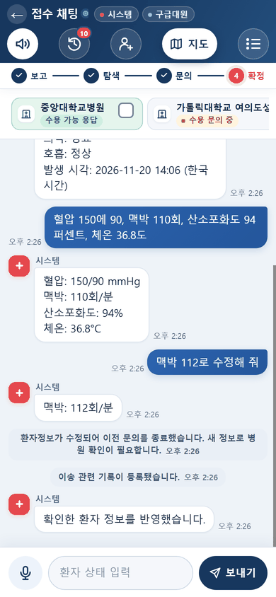
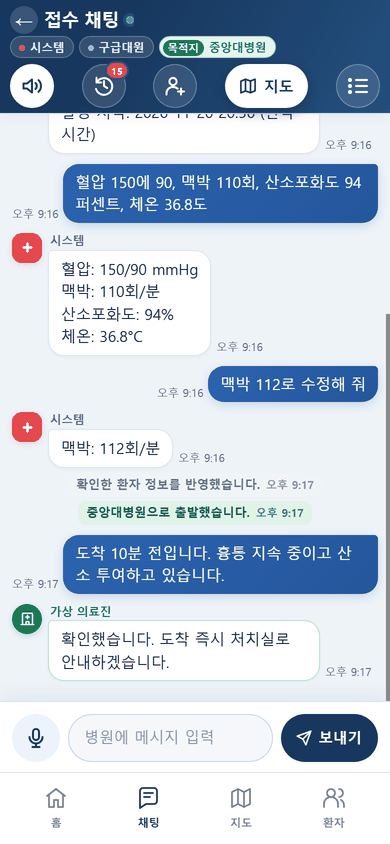
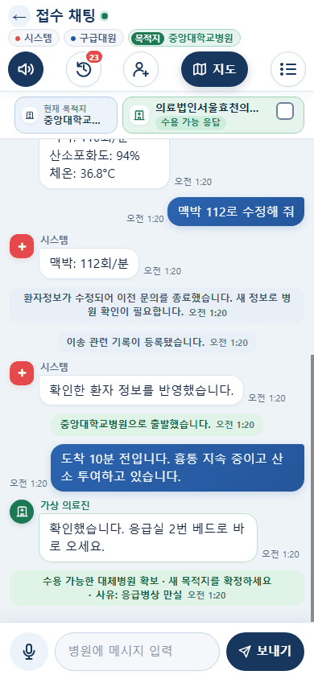
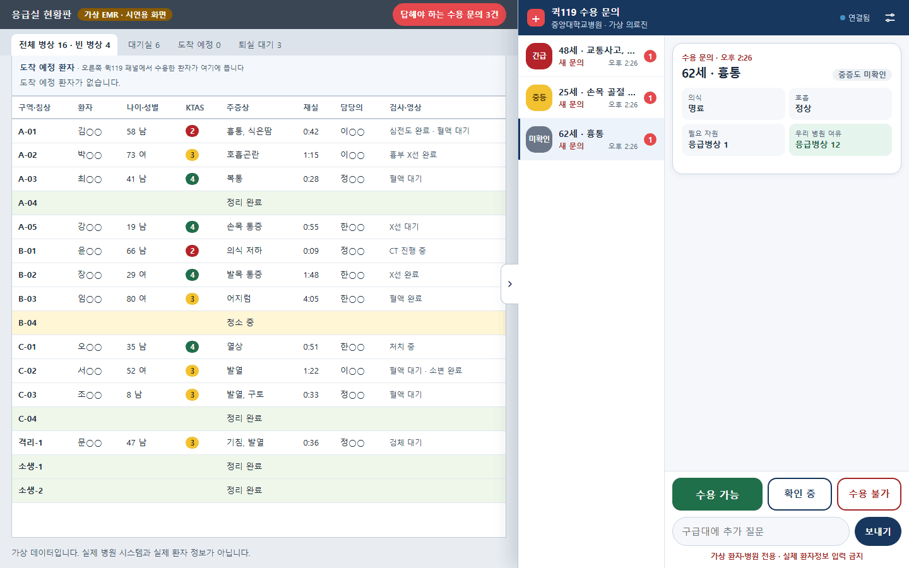
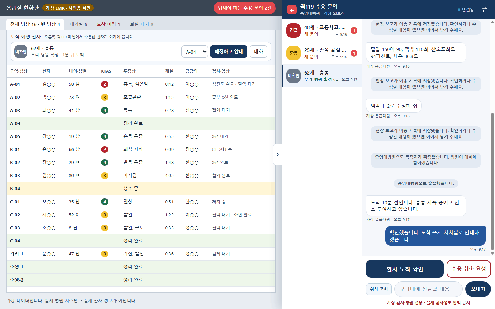

# Quick119

**응급환자 이송을 하나의 흐름으로.** 구급대원이 환자 상태를 한 번 보고하면, 조건에 맞는 병원 세 곳에 동시에 수용을 문의하고, 병원 회신부터 목적지 확정·이송 대화·도착 확인까지 같은 환자 기록으로 이어 주는 이송 지원 시스템입니다.

**인증 없는 가상 데이터 시연입니다. 실제 환자 정보, 실제 이송 또는 임상 판단에 사용하지 마세요

## 왜 만들었나

병상 정보가 공개돼 있어도, 구급대원이 받아 줄 병원을 찾는 일은 여전히 전화에 의존합니다. 발표 자료 2장에 정리한 공개 수치는 다음과 같습니다.

| 수치 | 내용 |
| --- | --- |
| 47.96% | 119구급스마트시스템의 병원 응답률(2025년). 56만 3,521건 중 27만 244건에만 병원이 회신했습니다. |
| +88% | 수용곤란 고지. 2023년 5만 8,520건에서 2024년 11만 33건으로 늘었습니다. |
| 67.3% | 종합상황판 사용이 불편하다고 답한 구급대원(759명 설문). |
| 29% | 병원이 답하지 못한 사유로 '인력 부족'을 든 응답(병원 응답자 470명). |

출처: Korea JoongAng Daily(2026-07-28), 뉴스핌(2025-04-17), 코메디닷컴·국립중앙의료원(NMC).

## 어떻게 풀었나

구급대원은 보고를 한 번만 합니다. 공통 서버가 환자 ID 하나에 문의·회신·자원·대화를 묶고, 구급대 앱과 병원 화면이 같은 기록을 봅니다.

| | 기존 방식 | Quick119 |
| --- | --- | --- |
| 문의 | 병원마다 차례로 전화하고, 수용 가능 여부만 전달 | 조건에 맞는 3곳에 동시에 문의하고, 사유와 추가 질문을 함께 주고받음 |
| 자원 | 병원이 직접 입력한 상황판 | 상황판 값에 더해, 확정·도착·퇴실 때 서버가 자동 반영 |
| 기록 | 전화·회신·상황판이 따로 | 환자 ID 하나에 진행 상태와 대화를 함께 |

계산과 전달은 시스템이 하고, **수용 응답과 목적지 확정은 사람이 합니다.**

## 화면

같은 저장소의 서버를 임시 DB로 실행하고, 헤드리스 Chrome으로 가상 환자 한 명(62세 흉통)을 접수부터 대체 병원까지 실제로 진행하며 촬영했습니다(2026-11-20, 휴대폰 390×844 · 병원 화면 1440×900). 환자·회신·자원은 모두 가상이고, 서울 시연 병원은 공개 자료를 바탕으로 구성한 시연 데이터입니다.

### 구급대 앱

| 접수 채팅 | 12항목 확인창 | 지도와 후보 3곳 |
| --- | --- | --- |
|  |  |  |
| 말이나 글로 보고하면 항목별로 정리해 답합니다. "맥박 112로 수정해 줘"처럼 채팅 한 줄로 고칩니다. | 애매하게 들린 값은 제안값으로 보여 주고, **확정**을 눌러야 들어갑니다. 하나로 읽을 수 없는 값은 '확인 필요'로 비워 둡니다. | 확인을 마치면 서버가 상위 3곳에 자동으로 문의합니다. 번호 핀과 후보 카드로 비교합니다. |

| 병원 회신 · 목적지 확정 | 병원 합류 · 이송 대화 | 수용 취소 · 대체 병원 |
| --- | --- | --- |
|  |  |  |
| 병원별 진행 상태는 위쪽 카드에 뜹니다. 수용 가능 카드의 체크를 눌러 목적지를 확정합니다. | 확정한 병원만 대화에 들어와, 앞서 보고한 내용을 그대로 봅니다. | 병원이 수용을 취소하면 현재 목적지를 유지한 채 새 병원에 문의합니다. 새 목적지도 구급대원이 확정합니다. |

지도 배경: [© OpenStreetMap 기여자](https://www.openstreetmap.org/copyright). 표시된 직선 경로와 시간은 가상 추정치로, 실제 길안내나 이송 판단에 사용할 수 없습니다.

### 병원 화면: EMR 옆 채팅 패널

병원에 웹 창을 하나 더 열게 하는 대신, 종일 보는 화면 옆에 붙는 채팅형 패널로 만들었습니다. 아래는 **시연용 가상 EMR 현황판** 옆에 패널을 붙인 화면이며, 실제 EMR과 연동한 것은 아닙니다.



EMR 위쪽에 답해야 할 문의 수가 뜨고, 패널에는 문의가 먼저 온 순서대로 환자가 한 줄씩 보입니다. 환자 요약을 보고 **수용 가능 · 확인 중 · 수용 불가** 세 버튼으로 회신합니다. 1440×900 화면에서 회신 버튼이 스크롤 없이 보입니다(이전 병원 웹 1,093px → 757px 위치).



목적지가 확정되면 같은 패널에서 대화가 열리고, 환자가 현황판의 도착 예정에 뜹니다. 침상을 골라 안내하면 구급대에 전달되고, 도착 확인과 수용 취소 요청도 여기서 합니다.

## 주요 기능

### 구급대 앱 (`quick119-pwa/`)

**보고와 확인**
- 홈의 **응급상황 접수 시작**으로 가상 접수를 만들고 접수 채팅(`/transport/`)을 엽니다.
- 말(브라우저 음성 인식)이나 글로 보고하면 서버가 나이·성별·증상·의식·호흡·혈압·맥박·산소포화도·체온·호흡수·혈당·발생 시각 12항목을 추출하고, 빠진 항목만 다시 묻습니다.
- 확실한 값만 바로 채웁니다. 애매한 값은 확인창에 **제안값**으로 보여 주고, 구급대원이 **확정**을 눌러야 초안에 들어갑니다.
  - 인식 후보끼리 엇갈리면 첫 후보를 제안하고 다른 후보를 함께 보여 줍니다.
  - 비슷하게 들린 말은 구급 용어로 제안합니다(흥통 → 흉통).
  - 붙어 들린 숫자는 다른 읽기를 제안합니다(120고 → 129).
- 하나로 읽을 수 없는 값(혈압 1876 등)은 짐작하지 않고 '확인 필요'로 비워 둡니다. 제안값을 모두 확정하거나 빼야 **확인하고 병원 탐색**이 눌립니다.

**채팅 명령**
- `맥박 92로 수정해 줘`(수정), `방금 입력 취소`(되돌리기), `질문 다시 해 줘`(질문 반복)를 채팅이나 음성으로 처리합니다.
- `전송해줘`는 12항목 확인창을 엽니다. 목적지가 확정된 뒤 `병원에 전화 연결해 줘`라고 하면 확정 병원의 전화 걸기 버튼을 띄웁니다.
- 수용 문의, 목적지 확정, 출발은 음성으로 실행하지 않고 화면 버튼으로만 합니다.

**탐색, 문의, 이송**
- 확인 후 서버가 진료 조건·자원·시연 이동시간으로 후보를 고르고 상위 3곳에 자동으로 문의합니다. 지도에 번호 핀과 후보 카드(순위·이동시간·병상 여유·판단 근거)를 보여 줍니다.
- 위쪽 카드에 병원별 상태(수용 문의 중·의료진 확인 중·수용 가능 응답·수용 불가·만료·종료)를 표시합니다. 확정하면 다른 병원 문의는 자동으로 끝나고, 확정 병원만 대화에 합류합니다.
- **이송 출발** 뒤 병원과 메시지를 주고받고, 경로 보기와 GPS 안내(거리·예상 시간, 카카오맵 링크)를 씁니다. `-SyntheticRoutes`에서는 가상 직선 경로임을 계속 표시합니다.
- 병원이 수용 취소를 요청하면 서버가 대체 병원에 문의합니다. 현재 목적지는 유지되고, 구급대원이 새 목적지를 확정해야 바뀝니다.

**화면과 기록**
- 4단계 진행 표시(보고 → 탐색 → 문의 → 확정)와 참여자·목적지 칩을 상단에 보여 주고, 전체 문의·회신 기록은 **진행 기록** 창에 시간순으로 남깁니다.
- 시스템 메시지를 한국어 음성으로 읽어 줍니다. PC의 Windows 음성을 먼저 쓰고, 없으면 브라우저 음성을 씁니다(`-EnableCloudSpeech`로 Microsoft 신경망 음성 선택).
- **환자 목록**에서 저장된 접수와 대화를 다시 열고, 조건을 만족하는 접수는 확인 후 삭제합니다.
- 휴대폰 키보드가 열리면 상단과 문의 카드를 줄여 대화와 입력칸을 남깁니다. 전송 결과가 불확실한 메시지는 같은 요청으로 다시 보내고, 3초마다 서버와 동기화합니다.
- PWA 설치 정보(manifest·서비스 워커)와 설치 점검 화면(`/pwa-check`)을 제공합니다.

### 병원 화면 (`hospital-ui/`)

- **채팅 패널** (`panel.html`): 기존 화면 옆에 좁은 창이나 사이드패널로 띄웁니다. 왼쪽에 환자 대화 목록, 오른쪽에 대화를 두고, 좁은 창에서는 목록에서 대화로 들어갑니다.
  - 목록은 문의가 먼저 온 순서이고, 줄마다 중증도 색과 확인할 건수 배지가 붙습니다. 끝난 대화(도착 확인·수용 불가·종료)는 아래에 묶어 한 줄로 접을 수 있습니다.
  - 환자 한 명이 대화 하나입니다. 환자 요약과 세 버튼으로 회신하고, 수용 불가는 인력·장비·병상·진료 불가·기타 중 사유를 고릅니다.
  - 추가 질문, 확정 뒤 이송 대화, 수용 유지·취소 요청, 도착 확인까지 같은 대화에서 이어집니다.
- **가상 EMR 시연 화면** (`emr-demo.html`): 가상 현황판 옆에 패널을 넣은 시연용 화면입니다. 패널에서 수용한 환자가 도착 예정에 뜨고, 침상을 배정하면 패널이 구급대에 안내하며, 도착 확인하면 그 침상에 들어갑니다. 침상 배정은 이 화면에만 있고 새로 고치면 사라집니다.
- **전체 병원 웹** (`index.html`): 수용 문의·도착 예정·이송 대화에 더해 병원 자원 조회, 수용 제한 등록·해제, 통화 기록, 업무 계측, 시스템 밖 환자 유입 등록·퇴실 같은 운영 도구를 다룹니다.

### 공통 서버 (`server/`)

- **수용 문의 흐름**: 후보 조회, 자동 문의, 회신(수용 가능·확인 중·불가와 사유, 추가 질문·답변), 재문의·취소, 수용 응답 유효시간(실험 설정 10분)을 관리합니다. 유효한 수용 응답이 생기면 추가 문의를 멈추고 담당자의 확정을 기다립니다. 응답이 없다고 거절로 보지 않고, 60초 뒤 문의 대상을 넓힙니다.
- **거절 사유 기억**: 최근 10분 안에 같은 조건의 환자를 병상·인력·장비·진료 불가로 거절한 병원은 다음 환자의 자동 문의에서 뺍니다. 이후 수용했거나 퇴실·자원 갱신으로 자리가 확인되면 다시 묻습니다. 공개 병상이 0이거나 값이 오래됐다는 이유만으로는 빼지 않고, 담당자가 직접 보내는 문의는 막지 않습니다.
- **자원 계산**: 신규 여유를 `총량 − 점유 − 확정 수요`로 계산해 확정·도착·퇴실 때 자동 반영합니다. 수용 응답만으로는 자리를 잡지 않습니다.
- **확정과 이송 상태**: 목적지 확정·출발·도착·미도착·퇴실과 목적지 변경을 같은 환자 ID로 기록합니다. 마지막 자리를 동시에 확정해도 한 명만 성공하고, 유효시간이 지난 수용 응답으로는 확정할 수 없습니다.
- **대화**: 구급대·병원·시스템 메시지를 참여 구간별로 저장하고, 병원은 참여한 구간만 조회합니다. 자유 메시지로는 수용·목적지가 바뀌지 않습니다.
- **음성 접수 API**: 받아쓰기·명령 판별·후속 질문·복창·되돌리기·확정과 제안값 확정을 제공합니다.
- **배정 계획**: CP-SAT 기반 배정 추천을 계산합니다. 시연용 `voice-only` 모드에서는 배정 솔버를 실행하지 않고 문의·대체 문의 워커만 실행합니다.

## 설계를 뒷받침한 수치

모두 가상·합성 조건의 결과이며, 현장 실측이나 업무시간 절감률이 아닙니다.

**음성 입력** — 인식 결과가 곧 환자 정보는 아닙니다.

| 조건 | 결과 |
| --- | --- |
| 개발 대본 120문장, 글로 입력 | 117문장에서 항목 추출이 완전히 일치 |
| 같은 대본을 합성 음성으로 만들어 인식 | 64문장으로 떨어짐(흉통 → "흥통", 119 ↔ 110구 같은 오인식) |
| 보완 뒤 같은 대본 | 64 → 73문장 일치 |
| 처음 보는 60발화 | 맞게 추출한 항목 52 → 61개(89개 중) |
| 실제 PC 마이크 13건(팀원 1명) | 문자 오류율 48.22%, 자동으로 채워진 27개 값 중 24개 정답 |

그래서 애매한 값은 제안만 하고 사람이 확정하도록 했습니다. 구급차 소음과 여러 화자는 검증하지 않았습니다. 근거 메모: [11장_실제마이크_안전지표_근거.md](최종발표준비/11장_실제마이크_안전지표_근거.md)

**문의 정책** — 한 번에 묻는 병원 수만 바꿔 비교했습니다(합성 실험, 96시나리오 · 환자 264명, 2026-10-12).

| 한 번에 묻는 병원 | 병원 문의 수 | 5분 안에 병원을 찾은 환자 |
| --- | --- | --- |
| 1곳 | 850건 | 222명 |
| **3곳(기본)** | 1,617건 | 229명 |
| 5곳 | 1,833건 | 229명 |

3곳은 5곳과 같은 환자 수를 찾으면서 문의를 11.8% 줄였고, 대가로 대기시간이 6.45초 늘었습니다.

## 한계

- 사용자 인증·권한이 없어 가상 데이터만 다루며, 서버는 `127.0.0.1`에서만 접속을 받습니다.
- 실제 병원·EMR과 연결하지 않습니다. 병원 회신과 자원은 모두 가상이고, EMR 화면은 시연용 가상 현황판입니다.
- 실제 EMR 연동과 응급실 의료진 사용성 평가는 하지 않았습니다.
- 음성 인식은 합성 음성과 실제 PC 마이크 1명·13건으로만 확인했습니다. 구급차 소음, 여러 화자, 실기기 GPS, 설치형 PWA는 검증하지 않았습니다.
- 인력·병상 부족 같은 공급 문제 자체를 해결하지는 않습니다.

## PC에서 시연 실행

Windows에서 Python 3을 설치하고, 저장소 루트의 PowerShell에서 다음을 실행합니다.

```powershell
cd quick119-pwa
python -m venv .venv
.\.venv\Scripts\python.exe -m pip install -r requirements.txt
```

`quick119-pwa` 폴더에서 PowerShell 터미널 두 개를 열어 각각 실행합니다.

```powershell
# 터미널 1: 합성 데이터 전용 공통 서버
powershell -NoProfile -ExecutionPolicy Bypass -File .\scripts\start-team-chat.ps1

# 터미널 2: 구급대 화면과 병원 화면
powershell -NoProfile -ExecutionPolicy Bypass -File .\scripts\start-chat-api.ps1 -SyntheticRoutes
```

두 서버가 실행되면 아래 주소를 엽니다.

| 화면 | 주소 |
| --- | --- |
| 퀵119 홈(**응급상황 접수 시작**) | <http://127.0.0.1:18034/> |
| 접수 채팅 | <http://127.0.0.1:18034/transport/> |
| 가상 EMR + 병원 패널 | <http://127.0.0.1:18034/hospital/emr-demo.html?hid=H01> |
| 병원 패널만 | <http://127.0.0.1:18034/hospital/panel.html?hid=H01> |
| 전체 병원 웹 | <http://127.0.0.1:18034/hospital/?hid=H01> |

- 기본 포트는 공통 서버 `18033`, 화면 서버 `18034`입니다. 충돌하면 첫 번째 명령의 `-Port`와 두 번째 명령의 `-Port`, `-TeamPort`를 맞춰 다른 포트를 지정하세요.
- 코드를 새로 받았으면 **두 서버를 모두** 다시 실행하세요. 제안값은 공통 서버에서 만들기 때문에, 공통 서버가 예전 코드로 떠 있으면 오류 없이 제안만 나오지 않습니다.
- 종료할 때는 각 실행 터미널에서 Ctrl+C를 누릅니다. 시연 DB는 `quick119-pwa/.local/`에 따로 보관되며, 오래된 가상 자원의 관측 시각만 갱신하려면 공통 서버 실행 시 `-RefreshSyntheticResources`를 지정합니다.
- 공통 서버가 실행되지 않으면 채팅은 오류를 명시하며, 다른 화면으로 전환하지 않습니다.

현재 통합 시연은 **같은 PC의 loopback 연결만 허용**합니다. 휴대폰 화면은 PC 브라우저 개발자 도구의 모바일 기기 크기로 시연하세요. 별도의 인증·보안 연결 없이 이 제한을 해제하거나 실제 환자 정보를 입력하지 마세요.

## 시연 순서

발표 시연과 같은 흐름입니다. 왼쪽에 접수 채팅(휴대폰 크기), 오른쪽에 가상 EMR + 병원 패널을 띄웁니다.

1. **보고**: 접수 채팅에서 "62세 남성, 20분 전부터 가슴 통증, 식은땀 있음, 의식 명료"처럼 말하거나 입력합니다. 항목별로 정리된 답이 옵니다.
2. **수정**: "맥박 112로 수정해 줘" — 그 항목만 바뀝니다.
3. **탐색**: **병원 탐색 시작**(또는 "전송해줘")으로 확인창을 열고, 제안값을 확정하거나 뺀 뒤 **확인하고 병원 탐색**을 누릅니다. 서버가 3곳에 문의합니다.
4. **회신**: 병원 패널에서 환자를 고르고 **수용 가능**을 누릅니다. 구급대 화면의 카드가 바로 바뀝니다.
5. **확정과 대화**: 수용 가능 카드의 체크로 목적지를 확정하고 **이송 출발**을 누릅니다. 양쪽에서 메시지를 주고받습니다.
6. **수용 취소**: 병원 패널에서 사유를 적고 **수용 취소 요청**을 보냅니다. 이미 물어본 병원은 빼고 새 병원에 문의합니다.
7. **재확정**: 대체 병원이 수용하면 구급대 화면에서 새 목적지를 확정합니다. 병원 패널에서 **환자 도착 확인**으로 마칩니다.

화면과 음성·경로 동작의 자세한 설명은 [이송 화면 안내](quick119-pwa/TRANSPORT_UI.md)를 참고하세요.

## 저장소 구성

| 경로 | 역할 |
| --- | --- |
| `quick119-pwa/` | FastAPI 백엔드, 구급대 PWA, 공통 서버 연결 및 실행 스크립트 |
| `hospital-ui/` | 병원 채팅 패널, 가상 EMR 시연 화면, 전체 병원 웹 |
| `server/`, `config/` | 공통 API, SQLite, 음성 접수, 문의·배정과 실행 설정 |
| `datasets/demo/` | 서울 시연 병원 자료 |
| `simulation/observed_inquiry.py`, `solver_improved.py`, `speech_eval/asr_correction.py` | 서버가 사용하는 문의·배정·음성 처리 |
| `tests/`, `quick119-pwa/tests/` | 회귀 테스트 |
| `images/readme/` | 이 문서의 화면 캡처 |
| `최종발표준비/` | 최종 발표 자료, 대본, 수치 근거 메모 |

## 테스트

저장소 루트에서 실행합니다.

```powershell
.\quick119-pwa\.venv\Scripts\python.exe -m pip install -r requirements\requirements-server.txt
.\quick119-pwa\.venv\Scripts\python.exe -m unittest discover -s tests\core
Push-Location quick119-pwa
$env:PYTHONPATH = ".;.."
.\.venv\Scripts\python.exe -m unittest discover -s tests
node --test tests\test_chat_intake.mjs
Pop-Location
```

브라우저 통합 테스트에는 Chrome이 필요합니다. 공통 서버의 `full` 모드와 일부 테스트는 고정 Python·SQLite 실행 프로필을 요구합니다. 핵심 테스트는 main 대상 PR과 푸시에서 자동으로 실행됩니다.
