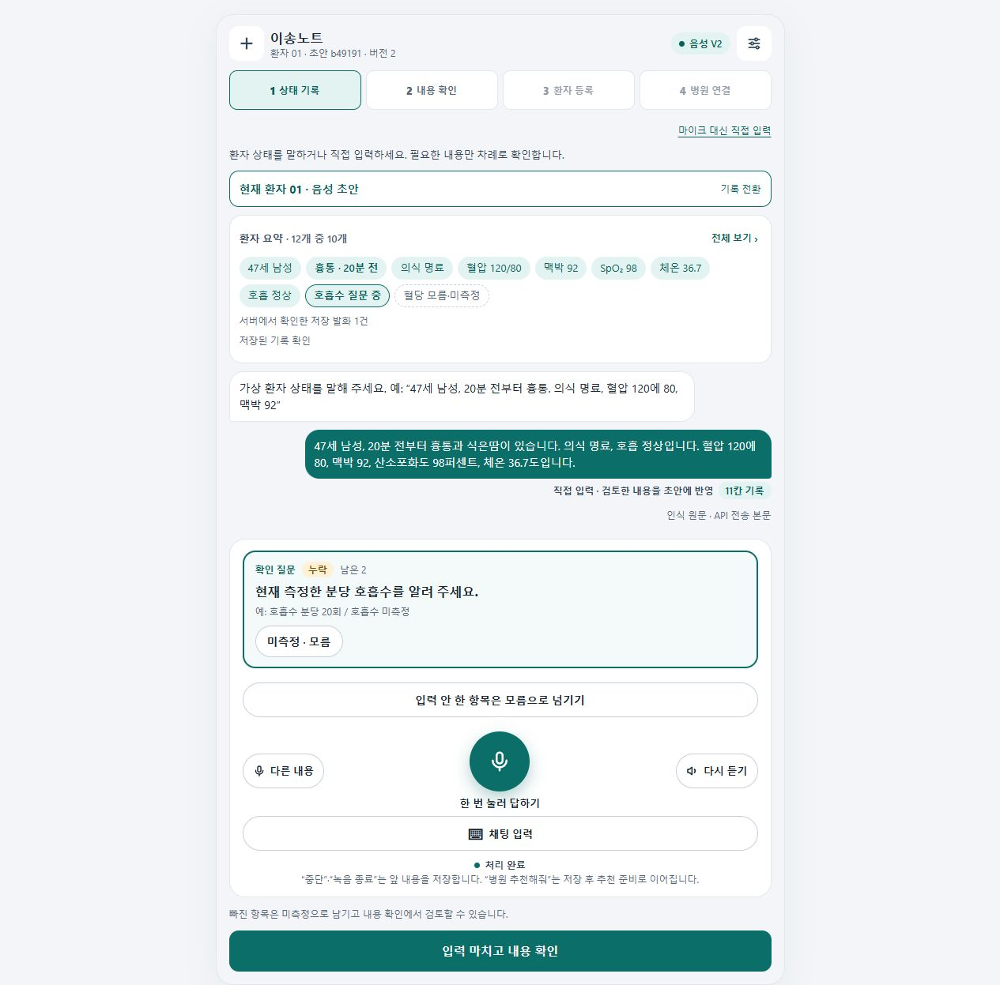
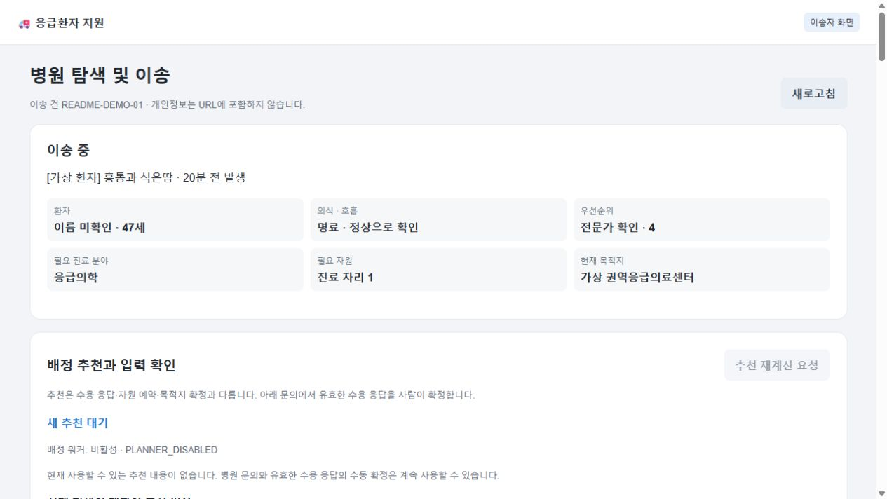
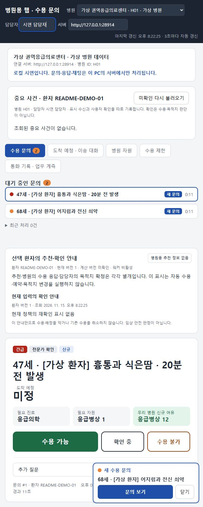
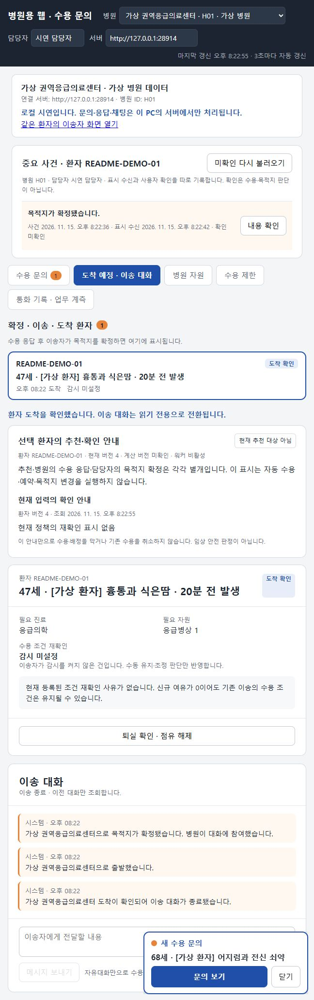

# 응급환자 병원 연결 시스템

구급대가 환자 상태와 치료 조건을 기록하면 공통 서버가 후보 병원에 수용 문의를 보냅니다. 병원은 수용 여부를 회신하고 이송자는 목적지를 확정합니다. 출발, 이송 중 조건 재검토, 도착과 퇴실까지 같은 환자 ID로 이어지는 캡스톤 프로젝트입니다.

[화면 미리 보기](#화면-미리-보기) · [연구 결과](#연구-결과) · [빠른 시연](#빠른-시연) · [문서 목차](docs/README.md)

## 연결하는 업무

**환자 기록 → 후보 탐색·수용 문의 → 병원 회신 → 담당자 목적지 확정 → 출발·이송 대화 → 도착 확인**

반복되는 병원 문의와 회신 대기를 한 흐름으로 관리하고, 이송 중 자원·치료 조건이 바뀌면 영향을 받는 환자를 재확인합니다. 알고리즘은 문의 대상과 배정안을 제안하며, 병원의 수용 응답과 담당자의 목적지 확정을 따로 기록합니다.

| 구성 | 주요 기능 | 구현 |
| --- | --- | --- |
| 구급대 화면 | 단계별 대화형 이송 노트, 음성·텍스트 기록, 중요 수치 확인, 인계 요약 | HTML·CSS·JavaScript |
| 이송 화면 | 후보 병원과 회신 확인, 목적지 확정, 출발, 병원과 대화 | HTML·CSS·JavaScript |
| 병원 화면 | 새 문의 알림, 수용·확인 중·불가 회신, 자원 조회·수용 제한 관리, 도착 확인 | HTML·CSS·JavaScript |
| 공통 서버 | JSON API, 문의·배정 워커, 이송 상태 관리, 수용·자원 제약 검증 | Python `ThreadingHTTPServer`·SQLite·OR-Tools |

환자 프로필과 음성 문진을 제공하는 별도 `emergency-app/`은 FastAPI를 사용합니다. 화면별 연결과 구현 범위는 [현재 구현 상태](docs/PROJECT_STATUS.md), 정책 설정은 [알고리즘 안내](docs/ALGORITHMS.md)에서 확인할 수 있습니다.

## 화면 미리 보기

2026-11-15 코드로 촬영한 **가상 환자·가상 병원 시연**입니다. 구급대 노트는 텍스트 입력으로 작성했고, 이송·병원 화면은 같은 환자의 수동 문의 → 수용 → 목적지 확정 → 출발 → 도착 확인을 보여줍니다. 촬영 시 자동 문의·배정 워커는 껐습니다. [촬영 조건과 원본](docs/images/readme/README.md)

### 구급대 — 대화형 이송 노트

현장 설명에서 환자 정보를 정리하고 누락 항목을 순서대로 확인합니다.



### 이송 — 같은 환자의 목적지와 진행 상태

병원의 수용 회신을 확인한 뒤 담당자가 목적지를 확정하고 출발한 화면입니다.



<details>
<summary><strong>병원 화면 펼쳐 보기 — 수용 문의와 도착 확인</strong></summary>

새 문의의 환자 상태·필요 자원을 보고 회신하고, 이송 완료 시 같은 환자의 도착을 확인합니다. 이미지를 누르면 원본 크기로 볼 수 있습니다.

| 수용 문의·새 문의 알림 | 도착 확인·이송 기록 |
| --- | --- |
| [](docs/images/readme/hospital-inquiry.jpg) | [](docs/images/readme/hospital-arrived.jpg) |

</details>

## 연구 결과

문의 정책은 **어디에 언제 물을지**, 배정 알고리즘은 **확인된 수용 후보와 한정된 자원을 어떻게 나눌지**를 다룹니다. 같은 외부 환경·비교 조건에서 평가하고, 미배정과 전체 시간뿐 아니라 개별 환자의 지연도 확인했습니다.

아래 수치는 저장소에 보관된 **합성 실험 결과**입니다. 각 행은 별도 실험이며, 실제 환자의 임상 효과나 현장 업무시간을 측정한 값으로 해석하지 않습니다.

| 비교와 범위 | 확인한 결과 | 함께 확인한 한계 |
| --- | --- | --- |
| **현재 솔버의 배정 품질** — CP-SAT `severity_first`와 순차 대체안, seed 9의 입력 50개·탐색 3초 | 관측 입력에서 양쪽 해가 유효한 **46개 중 목적값 개선 20개·동률 26개** | 숨겨진 사후 조건에서는 **5/46개가 제약 위반**. 순차안을 초기 해로 보존하므로 비열세는 설계상 기대되는 결과. [근거](docs/ALLOCATION_PRESENTATION_EVIDENCE_20261105.md#현재-솔버의-추가-스냅샷-비교) |
| **문의 규모와 검토 부담** — 고정 5곳 → 고정 3곳, 동일 96시나리오·264명 | 선정 **229명 유지**, 문의 **1,833 → 1,617건(−11.8%)**, 모의 검토 활동시간 **99,790 → 86,008초(−13.8%)** | 전체 환자의 제한 선정 대기는 평균 **+6.45초**. 문의 절감과 대기 증가를 함께 평가. [사례별 수치](docs/evidence/20261105/resource-workload.json) |
| **희소 자원의 공동 배정 연구** — 거리순 R1 → C1, 동일 108시나리오·433명 | 미배정 **108 → 41명**, 문의 **2,278 → 1,275건** | 긴 우회 사례에서는 기존 환자 도착이 **47분 지연**. C1은 현재 서버와 목적함수가 다른 연구 정책. [실험 조건](docs/ONLINE_ALLOCATION.md) · [집계 근거](docs/evidence/20261105/resource-workload.json) |

**현재 채택한 설정:** 기본 문의는 `fixed_3`, `team_runtime full`의 배정은 CP-SAT `severity_first`(3초)입니다. 우선순위군별 미배정 수를 먼저 줄이고, 동률이면 같은 군 순서로 등록부터 예정 치료 시작까지의 시간 합을 줄입니다. H1·W1은 개인 지연 등의 한계 때문에 운영 기본으로 채택하지 않았습니다. [채택 상태](docs/ALGORITHMS.md) · [최종 결정과 반례](docs/FINAL_ALGORITHM_DECISION_20261030.md)

CP-SAT의 최적성 증명은 **현재 입력의 배정 모형**에 적용됩니다. 위 46개에서 최적성을 증명한 26개와 목적값이 개선된 20개는 서로 다른 집계이며, 미래 변화가 포함된 전체 이송의 최적성을 뜻하지 않습니다.

### 결과 확인과 재현 범위

```powershell
python docs/evidence/20261105/verify.py
```

이 명령은 저장된 사례별 수치와 해시를 다시 검사합니다. 새 성능 실험을 실행하는 명령은 아닙니다. 원본 대용량 기록 일부는 Git에 포함되지 않으며, [manifest](docs/evidence/20261105/manifest.json)의 소스 커밋은 재현용 참조입니다. 해당 실행 당시의 소스·런타임 해시는 원래 결과에 없습니다. 전체 재실행 조건은 각 실험 문서를 따릅니다.

추가 연구는 [문의 정책 V3](docs/INQUIRY_V3_EXPERIMENT.md), [전체 이송 정책 비교](docs/JOINT_POLICY_EXPERIMENT.md), [음성 평가 도구](speech_eval/README.md)에 정리했습니다. 음성 인식 후처리 실험 모듈과 실제 구급대 화면의 연결 여부는 따로 확인해야 하며, 이 README의 화면은 실제 마이크·사이렌 환경의 인식 성능을 검증한 자료가 아닙니다.

## 빠른 시연

Windows PowerShell에서 Python 3.12를 준비한 뒤 저장소 루트에서 실행합니다. 아래 명령은 실행할 때마다 새 가상 DB를 만듭니다.

```powershell
py -3.12 -m venv .venv
.\.venv\Scripts\python.exe -m pip install -r requirements/requirements-server.txt
$demoDb = 'data/demo-' + [guid]::NewGuid().ToString('N') + '.db'
.\.venv\Scripts\python.exe -B -m server.chat_demo --db $demoDb --port 18020
```

1. [구급대 화면](http://127.0.0.1:18020/paramedic/)에서 가상 환자를 입력하고 등록합니다.
2. 등록 결과의 이송 링크에서 문의를 시작합니다. [병원 H01](http://127.0.0.1:18020/hospital/?hid=H01)에 문의가 들어오면 수용으로 회신합니다. 문의를 받은 다른 가상 병원도 상단에서 선택할 수 있습니다.
3. 이송 화면에서 목적지를 확정하고 출발합니다. 해당 병원 화면의 **도착 예정 · 이송 대화**에서 같은 환자의 도착을 확인합니다.

이 시연은 가상 병원과 거리 기반 이동시간을 사용합니다. 문의·배정 워커를 함께 켜거나 다른 기기에서 연결하려면 [실행 안내](docs/RUNNING.md)를 참고하세요. [전체 시연 순서](docs/DEMO.md)

## 저장소 구조

| 경로 | 역할 |
| --- | --- |
| `server/`, `config/` | 공통 JSON API, SQLite, 문의·배정 워커, 이송 상태와 자원 처리 |
| `paramedic-ui/`, `patient-ui/`, `hospital-ui/` | 구급대 기록, 이송 진행, 병원 수용·검토 화면 |
| `emergency-app/` | 별도 환자 프로필·음성 문진 앱(FastAPI). 접수를 공통 이송 흐름으로 연결 |
| `simulation/`, `inquiry_lab/`, `simulation_results/` | 배정 재생, 문의 정책 실험과 결과 |
| `speech_eval/`, `voice_lab/`, `usability_eval/` | 음성·명령·사용성 평가 도구 |
| `tests/core/`, `tests/browser/`, `tests/research/` | 서버·팀 실행, 화면, 알고리즘 연구 테스트 |
| `scripts/`, `requirements/` | 공통 검증·시연 실행 도구와 용도별 Python 의존성 |
| `docs/`, `datasets/`, `archive/` | 팀 문서와 발표 근거, 공개·합성 자료, 이전 산출물 |

`solver_improved.py`는 서버 배정과 검증 프로필이 경로·해시를 고정하는 실행 모듈입니다.

## 개발과 검증

PR을 검토할 때는 현재 구현 상태와 팀 인계에서 화면별 작업 범위를 먼저 확인하세요. 요청·응답 계약과 연구 자료는 문서 목차에 모았습니다. [현재 구현 상태](docs/PROJECT_STATUS.md) · [팀 인계](docs/team-handoff/20261105/README.md) · [문서 목차](docs/README.md)

아래 검증 명령은 Git으로 클론한 저장소에서 실행합니다.

```powershell
.\.venv\Scripts\python.exe -m pip install -r requirements/requirements-server.txt -r requirements/requirements-intake-test.txt
.\.venv\Scripts\python.exe scripts/test_suites.py list
.\.venv\Scripts\python.exe scripts/test_suites.py core
```

화면 테스트에는 Node 24가 필요합니다. 공통 실행·배정 기준을 검사할 때는 CI와 같은 고정 Python·SQLite·OR-Tools 버전을 사용하세요. `core`는 `main` 대상 PR과 `main` 푸시에서 실행합니다. [검증 안내](docs/TESTING.md)
