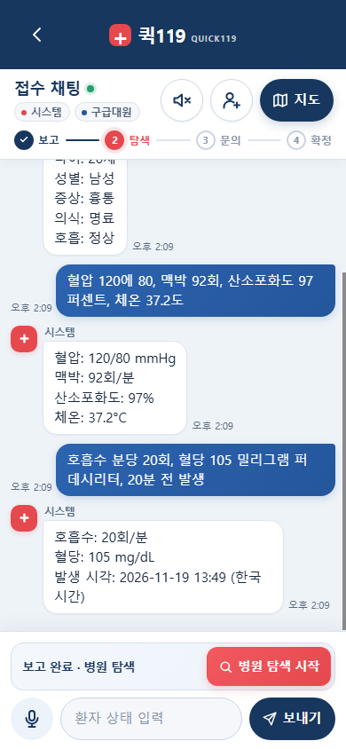
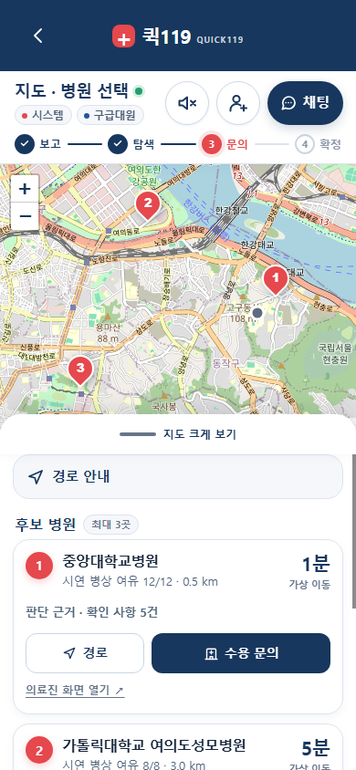
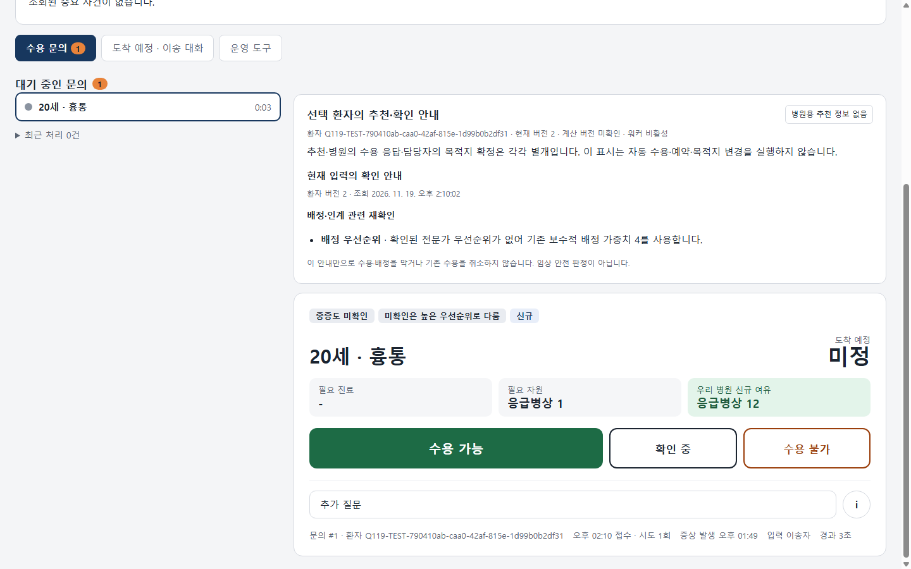

# Quick 119

구급대원이 환자 상태를 대화로 기록하고 후보 병원에 수용을 문의하는 이송 지원 시연입니다. 병원은 웹에서 문의에 회신하고, 구급대원이 목적지를 확정하면 양쪽에서 이송 상태와 대화를 공유합니다.

**인증 없는 가상 데이터 시연입니다. 실제 환자 정보, 실제 이송 또는 임상 판단에 사용하지 마세요.**

## 주요 화면

아래 화면은 같은 저장소의 서버를 별도 포트와 임시 DB로 실행해 촬영했습니다. 환자 상태와 응답은 가상이며, 서울 시연 병원은 공개 자료를 바탕으로 구성한 시연 데이터입니다.

| 구급대 접수 채팅 | 환자 정보 최종 확인 | 지도와 후보 병원 |
| --- | --- | --- |
|  |  |  |
| 환자 상태를 글이나 음성으로 보고합니다. 상단 스피커로 시스템 메시지 낭독을 켜고 끌 수 있습니다. | 나이·증상·활력징후 등 추출 결과와 보고 원문을 확인한 뒤 병원 탐색을 시작합니다. | 후보의 시연 이동시간과 병상 여유를 보고 경로를 확인하거나 수용을 문의합니다. |

지도 배경: [© OpenStreetMap 기여자](https://www.openstreetmap.org/copyright). 표시된 직선 경로와 시간은 가상 추정치로 실제 길안내나 이송 판단에 사용할 수 없습니다.

### 병원 웹

병원 담당자는 **수용 문의**에서 대기 중인 가상 환자를 선택하고 필요한 정보와 자원을 확인합니다. **수용 가능**, **확인 중**, **수용 불가** 중 하나로 회신할 수 있습니다.




구급대원이 수용된 병원을 목적지로 확정한 후에는 **도착 예정 · 이송 대화**에서 같은 환자의 이송 상태와 메시지를 확인하고 도착을 처리합니다.

## PC에서 시연 실행

Windows에서 Python 3을 설치하고, 저장소 루트의 PowerShell에서 다음을 실행합니다.

```powershell
cd quick119-pwa
python -m venv .venv
.\.venv\Scripts\python.exe -m pip install -r requirements.txt
```

`quick119-pwa` 폴더에서 PowerShell 터미널 두 개를 열어 각각 실행합니다.

```powershell
# 터미널 1: 합성 데이터 전용 공통 서버
powershell -NoProfile -ExecutionPolicy Bypass -File .\scripts\start-team-chat.ps1

# 터미널 2: 구급대 화면과 병원 웹
powershell -NoProfile -ExecutionPolicy Bypass -File .\scripts\start-chat-api.ps1 -SyntheticRoutes
```

브라우저에서 [구급대 접수 화면](http://127.0.0.1:18034/transport/) 또는 [병원 웹](http://127.0.0.1:18034/hospital/?hid=H01)을 엽니다. 병원 웹 상단에서 가상 병원과 담당자 이름을 선택할 수 있습니다.

- 기본 포트는 공통 서버 `18033`, 화면 서버 `18034`입니다. 충돌하면 첫 번째 명령의 `-Port`와 두 번째 명령의 `-Port`, `-TeamPort`를 맞춰 다른 포트를 지정하세요.
- 종료할 때는 **각 실행 터미널에서** Ctrl+C를 누릅니다. 시연 DB는 `quick119-pwa/.local/`에 따로 보관되며, 오래된 가상 자원의 관측 시각만 갱신하려면 공통 서버 실행 시 `-RefreshSyntheticResources`를 지정합니다.
- 공통 서버는 `voice-only` 모드입니다. 수동 수용 문의는 가능하지만 자동 문의·배정 워커는 실행하지 않습니다.

## 구급대 모바일 화면 사용

현재 통합 시연은 **같은 PC의 loopback 연결만 허용**합니다. 휴대폰에서 PC의 LAN 주소로 접속하는 연결은 지원하지 않으므로, PC 브라우저의 개발자 도구에서 모바일 기기 화면 크기로 전환해 시연하세요. 별도의 인증·보안 연결 없이 이 제한을 해제하거나 실제 환자 정보를 입력하지 마세요. 휴대폰 설치·마이크 사용에는 지원 브라우저와 HTTPS 등 보안 컨텍스트도 필요합니다.

1. `/transport/`에서 가상 환자 상태를 입력하고 **보내기**를 누릅니다. 지원 브라우저에서는 마이크로 입력할 수 있으며, 음성 인식은 브라우저 제공자의 서버에서 처리될 수 있습니다.
2. 시스템이 인식한 항목을 채팅에 보여 줍니다. 상단 **환자 정보 확인** 버튼으로 저장된 정보를 조회하고, 스피커 버튼으로 시스템 메시지 낭독을 켜거나 끕니다.
3. **병원 탐색 시작**을 눌러 추출 정보와 보고 원문을 확인한 후 **확인하고 병원 탐색**을 누릅니다. 지도에서 후보의 **수용 문의**를 선택하고 **의료진 화면 열기**로 해당 병원 웹을 엽니다.
4. 병원 웹에서 문의를 선택해 **수용 가능**을 누릅니다. 구급대 화면에서 해당 병원을 **목적지 확정**하면 병원이 대화에 참여합니다.
5. **이송 출발** 후 양쪽에서 메시지를 주고받습니다. 병원 웹의 **도착 예정 · 이송 대화**에서 환자를 선택해 **도착 확인**을 누릅니다.

기본 낭독은 PC에 설치된 Windows 한국어 음성을 사용하고, 사용할 수 없으면 기기 브라우저의 음성으로 대체합니다. `-EnableCloudSpeech`를 명시하면 낭독 문장이 Microsoft로 전송됩니다. 더 자세한 화면과 음성·경로 동작은 [이송 화면 안내](quick119-pwa/TRANSPORT_UI.md)를 참고하세요.

## 저장소 구성

| 경로 | 역할 |
| --- | --- |
| `quick119-pwa/` | FastAPI 백엔드, 구급대 PWA, 공통 서버 연결 및 실행 스크립트 |
| `hospital-ui/` | 병원 수용 문의·이송 대화 웹 |
| `server/`, `config/` | 공통 API, SQLite, 음성 접수, 문의·배정과 실행 설정 |
| `datasets/demo/` | 서울 시연 병원 자료 |
| `simulation/observed_inquiry.py`, `solver_improved.py`, `speech_eval/asr_correction.py` | 서버가 사용하는 문의·배정·음성 처리 |
| `tests/`, `quick119-pwa/tests/` | 유지된 기능의 회귀 테스트 |

## 검증

저장소 루트에서 실행합니다.

```powershell
.\quick119-pwa\.venv\Scripts\python.exe -m pip install -r requirements\requirements-server.txt
.\quick119-pwa\.venv\Scripts\python.exe -m unittest discover -s tests\core
Push-Location quick119-pwa
$env:PYTHONPATH = ".;.."
.\.venv\Scripts\python.exe -m unittest discover -s tests
node --test tests\test_chat_intake.mjs
Pop-Location
```

브라우저 통합 테스트에는 Chrome이 필요합니다. 공통 서버의 `full` 모드와 일부 테스트는 고정 Python·SQLite 실행 프로필을 요구합니다.
