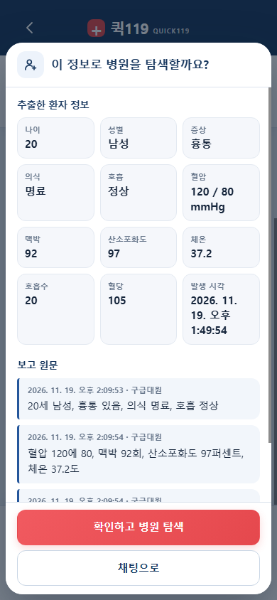
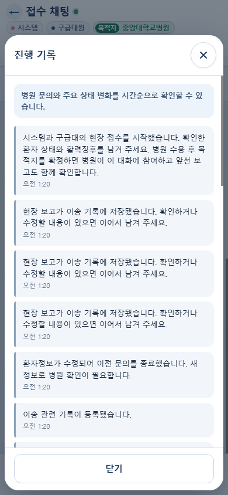
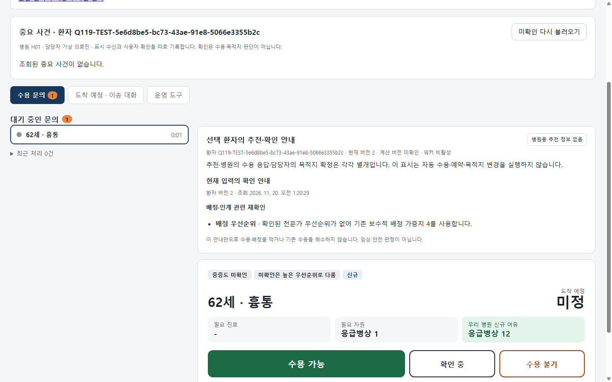
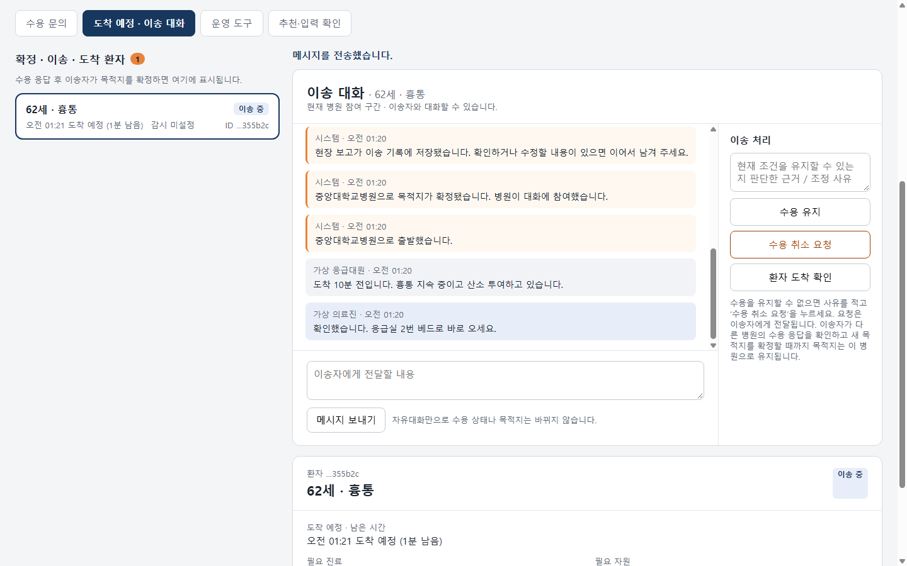

# Quick 119

구급대원이 환자 상태를 대화로 기록하고 후보 병원에 수용을 문의하는 이송 지원 시연입니다. 병원은 웹에서 문의에 회신하고, 구급대원이 목적지를 확정하면 양쪽에서 이송 상태와 대화를 공유합니다. 확정한 병원이 수용을 유지하지 못하면 서버가 대체 병원에 다시 문의하고, 구급대원이 새 목적지를 확정합니다.

**인증 없는 가상 데이터 시연입니다. 실제 환자 정보, 실제 이송 또는 임상 판단에 사용하지 마세요.**

## 주요 화면

아래 화면은 같은 저장소의 서버를 별도 포트와 임시 DB로 실행하고, 헤드리스 Chrome으로 접수부터 대체 병원 확정까지 실제로 진행하며 촬영했습니다(2026-11-20, 휴대폰 390×844 · 병원 웹 1440×900). 환자 상태와 응답은 가상이며, 서울 시연 병원은 공개 자료를 바탕으로 구성한 시연 데이터입니다.

### 구급대 모바일 화면

| 접수 채팅 | 환자 정보 최종 확인 | 지도와 후보 병원 |
| --- | --- | --- |
|  |  |  |
| 글이나 음성으로 보고하면 항목별로 정리해 답합니다. "맥박 112로 수정해 줘"처럼 채팅으로 고칩니다. | 12항목과 보고 원문을 확인한 뒤 병원 탐색을 시작합니다. 모르는 항목은 `미확인`으로 남습니다. | 서버가 상위 후보 3곳에 수용을 문의합니다. 시연 이동시간·병상 여유와 판단 근거를 봅니다. |

| 수용 응답 · 목적지 확정 | 병원 합류 · 이송 대화 | 병원 조정 · 대체 병원 | 진행 기록 |
| --- | --- | --- | --- |
|  |  |  |  |
| 문의 상태는 가로로 넘기는 카드로 봅니다. 수용 가능 카드의 체크를 눌러 목적지를 확정합니다. | 확정한 병원만 대화에 들어오고 앞선 보고를 함께 봅니다. 문의·확정·출발은 가운데 얇은 띠로 표시됩니다. | 병원이 수용 취소를 요청하면 현재 목적지와 대체 병원 카드가 나옵니다. 새 목적지는 구급대원이 확정합니다. | 채팅에서 뺀 병원 문의·회신 기록은 상단 기록 버튼에서 시간순으로 확인합니다. |

지도 배경: [© OpenStreetMap 기여자](https://www.openstreetmap.org/copyright). 표시된 직선 경로와 시간은 가상 추정치로 실제 길안내나 이송 판단에 사용할 수 없습니다.

### 병원 웹



**수용 문의**에서 대기 중인 가상 환자를 선택하고 필요한 진료·자원과 우리 병원 신규 여유를 확인한 뒤 **수용 가능**, **확인 중**, **수용 불가** 중 하나로 회신합니다.



구급대원이 목적지를 확정하면 **도착 예정 · 이송 대화**에서 도착 예정 시각과 대화를 확인하고, **수용 유지**, **수용 취소 요청**(사유 입력), **환자 도착 확인**을 처리합니다.

## 구현된 기능

### 구급대 앱 (`quick119-pwa/`)

**접수와 보고**
- 홈의 **응급상황 접수 시작**으로 새 가상 접수를 만들고 접수 채팅(`/transport/`)을 엽니다. 예전 `/emergency`, `/voice-intake` 주소도 같은 화면으로 이동합니다.
- 환자 상태를 글이나 브라우저 음성 인식으로 보고합니다. 서버가 나이·성별·증상·의식·호흡·혈압·맥박·산소포화도·체온·호흡수·혈당·발생 시각 12항목을 추출해 항목별로 답하고, 빠진 항목을 다시 묻습니다.
- 인식 후보끼리 숫자나 부정이 엇갈리면 그 항목만 재확인합니다. 용어 교정은 후보로만 보여 주고, 숫자는 바꾸지 않고 확인 표시만 붙입니다.

**채팅 명령**
- `맥박 92로 수정해 줘`(수정), `방금 입력 취소`(되돌리기), `질문 다시 해 줘`(질문 반복)를 채팅이나 음성으로 처리합니다.
- `전송해줘`는 12항목 확인창을 열고, **확인하고 병원 탐색**을 눌러야 반영합니다.
- 목적지가 확정된 뒤 `병원에 전화 연결해 줘`라고 하면 확정 병원의 전화 걸기 버튼을 띄웁니다.
- 수용 문의, 목적지 확정, 출발은 음성으로 실행하지 않고 화면 버튼으로만 합니다.

**병원 탐색과 지도**
- 최종 확인 후 서버가 진료 조건·자원·시연 이동시간으로 후보를 고르고 상위 3곳에 자동으로 수용을 문의합니다.
- 지도에 번호 핀(1~3)과 접수 위치를 표시하고, 후보 카드에 순위·이동시간·응급병상 여유·판단 근거를 보여 줍니다.
- 경로 보기와 실시간 GPS 안내(거리·예상 시간, 내 위치 따라가기, 카카오맵 링크)를 지원합니다. `-SyntheticRoutes`에서는 가상 직선 경로임을 계속 표시합니다.

**문의, 확정, 이송**
- 상단 가로 카드에 병원별 문의 상태(수용 문의 중·의료진 확인 중·수용 가능 응답·수용 불가·만료·종료)를 표시하고, 수용 가능 카드의 체크로 목적지를 확정합니다.
- 확정하면 다른 병원 문의는 자동으로 종료되고, 확정 병원만 대화에 합류해 확정 전 보고를 함께 봅니다.
- **이송 출발** 후 병원과 메시지를 주고받습니다. 지도를 보는 동안 온 의료진 메시지는 배지로 알립니다.
- 병원이 수용 취소를 요청하면 서버가 대체 병원에 자동으로 문의합니다. 현재 목적지를 유지한 채 대체 병원 카드가 나오며, 구급대원이 새 목적지를 확정해야 바뀝니다.

**화면과 기록**
- 4단계 진행 표시(보고 → 탐색 → 문의 → 확정), 참여자 칩, 목적지 칩을 헤더에 보여 줍니다.
- 문의·확정·조정 같은 시스템 이벤트는 가운데 얇은 띠로 보여 주고, 전체 문의·회신 기록은 **진행 기록** 창에 시간순으로 남깁니다.
- 시스템 메시지를 한국어 음성으로 읽어 줍니다. PC의 Windows 음성을 먼저 쓰고, 없으면 브라우저 음성을 씁니다(`-EnableCloudSpeech`로 Microsoft 신경망 음성 선택).
- **환자 목록**에서 저장된 접수와 대화를 다시 열고, 조건을 만족하는 접수는 확인 후 삭제합니다.
- 휴대폰 키보드가 열리면 헤더와 문의 카드를 줄여 대화와 입력칸을 남기는 입력 집중 모드로 바뀝니다.
- 전송 결과가 불확실한 메시지는 같은 요청으로 다시 보내고, 3초마다 서버와 동기화합니다.
- PWA 설치 정보(manifest·서비스 워커)와 설치 점검 화면(`/pwa-check`)을 제공합니다.

### 병원 웹 (`hospital-ui/`)

- **수용 문의**: 대기 문의를 한 줄씩 보여 주고, 선택한 환자의 요약·필요 진료·필요 자원·우리 병원 신규 여유를 표시합니다. 큰 버튼 세 개로 회신하며, 수용 불가는 인력·장비·병상·진료 불가·기타 중 사유를 고릅니다. 추가 질문과 구급대 전화 연결도 여기서 합니다.
- **새 문의 알림**: 다른 탭에서 일하는 중에도 새 문의를 팝업으로 알리고, 대기 건수를 탭에 계속 표시합니다. 처리된 문의의 알림은 자동으로 사라집니다.
- **도착 예정 · 이송 대화**: 확정·이송·도착 환자와 도착 예정 시각을 보고, 이송 대화와 수용 유지·수용 취소 요청·도착 확인을 처리합니다.
- **이송 중 변경 검토**: 이송 중 환자 상태가 바뀌어 판단이 필요한 환자를 메인 화면에 표시합니다.
- **중요 사건**: 목적지 확정 같은 중요 사건의 화면 수신과 담당자 확인 시각을 따로 기록합니다.
- **운영 도구**: 병원 자원(조회 전용, 서버 자동 반영), 수용 제한 등록·해제, 통화 기록·내용 확인, 업무 시작·종료 계측, 시스템 밖 환자 유입 등록·퇴실을 다룹니다.
- **추천·입력 확인**: 서버가 계산한 배정 추천과 입력 확인 안내를 읽기 전용으로 보여 줍니다.
- **채팅 패널** (`panel.html`): 병원이 쓰던 화면 옆에 좁은 창이나 사이드패널로 띄우는 채팅형 화면입니다. 메신저처럼 왼쪽에 환자 대화 목록, 오른쪽에 대화를 두며 좁은 창에서는 목록에서 대화로 들어갑니다. 목록은 문의가 먼저 온 순서이고 줄마다 중증도 색과 글자, 확인할 건수 배지를 붙입니다. 끝난 대화(도착 확인·수용 불가·종료)는 아래에 따로 묶고 한 줄로 접을 수 있습니다. 환자 한 명이 대화 하나이고, 환자 요약 카드와 버튼 세 개(수용 가능·확인 중·수용 불가)로 회신합니다. 추가 질문, 확정 뒤 이송 대화, 수용 유지·취소 요청, 도착 확인까지 같은 대화에서 이어집니다. 자원·수용 제한·운영 도구는 넣지 않았고 전체 병원 웹으로 가는 링크만 둡니다. 답해야 하는 건수를 탭 제목에 표시하고, 설정에서 브라우저 알림과 알림음을 켤 수 있습니다.

### 공통 서버 (`server/`)

- **수용 문의 흐름**: 후보 조회, 자동 문의 워커, 회신(수용 가능·확인 중·불가와 사유, 추가 질문·답변), 재문의·취소, 수용 응답 유효시간(실험 설정 10분)을 관리합니다. 유효한 수용 응답이 생기면 추가 문의를 멈추고 담당자의 확정을 기다립니다.
- **거절 사유 기억**: 최근 10분 안에 같은 조건의 환자를 '병상'·'인력'·'장비'·'진료 불가'로 거절한 병원은 다음 환자의 자동 문의(대체 병원 문의 포함)에서 뺍니다. '병상'은 필요 자원이 겹치는 환자에게, 나머지는 같은 진료 분야가 필요한 환자에게만 적용합니다. 이후 같은 조건의 환자를 수용했거나 퇴실·자원 갱신으로 자리가 확인되면 다시 묻고, 제외 사실은 구급대원 진행 기록에 남깁니다. 담당자가 직접 보내는 문의는 막지 않습니다.
- **확정과 이송 상태**: 목적지 확정·출발(도착 예정 시각)·도착·미도착·퇴실과 목적지 변경을 같은 환자 ID로 기록합니다.
- **자원 계산**: 신규 여유를 `총량 − 점유 − 확정 수요`로 계산하고, 확정·도착·퇴실 때 자동 반영합니다. 수용 응답만으로는 자리를 잡지 않습니다.
- **조정과 재확인**: 수용 취소 요청 시 대체 병원 자동 문의, 바뀐 조건에 영향받는 환자만 재확인, 이송 중 환자 변경 검토를 지원합니다.
- **대화**: 구급대·병원·시스템 메시지를 참여 구간별로 저장하고, 병원은 참여한 구간만 조회합니다. 자유 메시지로는 수용·목적지가 바뀌지 않습니다.
- **기록과 계측**: 통화 결과 기록과 상대 기관의 내용 확인, 업무 활동 계측, 중요 사건 수신·확인, 외부 유입, 정산 대사, 공공데이터 출처를 API로 제공합니다.
- **음성 접수 API**: 음성 세션의 받아쓰기·명령 판별·후속 질문·복창·되돌리기·확정과 치료 조건 변경 검토를 제공합니다.
- **배정 계획**: CP-SAT 기반 배정 추천을 계산합니다. 시연용 `voice-only` 모드에서는 배정 솔버를 실행하지 않고 문의·대체 문의 워커만 실행합니다.

### 제한

- 사용자 인증·권한이 없어 가상 데이터만 다루며, 서버는 `127.0.0.1`에서만 접속을 받습니다.
- 실제 병원·EMR과 연결하지 않으며, 병원 회신과 자원은 모두 가상입니다.
- 실제 마이크·사이렌 환경의 음성 인식, 실기기 GPS, 설치형 PWA는 검증하지 않았습니다.

## PC에서 시연 실행

Windows에서 Python 3을 설치하고, 저장소 루트의 PowerShell에서 다음을 실행합니다.

```powershell
cd quick119-pwa
python -m venv .venv
.\.venv\Scripts\python.exe -m pip install -r requirements.txt
```

`quick119-pwa` 폴더에서 PowerShell 터미널 두 개를 열어 각각 실행합니다.

```powershell
# 터미널 1: 합성 데이터 전용 공통 서버
powershell -NoProfile -ExecutionPolicy Bypass -File .\scripts\start-team-chat.ps1

# 터미널 2: 구급대 화면과 병원 웹
powershell -NoProfile -ExecutionPolicy Bypass -File .\scripts\start-chat-api.ps1 -SyntheticRoutes
```

두 서버가 실행되면 [퀵119 홈](http://127.0.0.1:18034/)에서 **응급상황 접수 시작**을 눌러 접수 채팅을 시작하세요. [접수 채팅](http://127.0.0.1:18034/transport/)으로 바로 열 수도 있고, [병원 웹](http://127.0.0.1:18034/hospital/?hid=H01) 상단에서 가상 병원과 담당자 이름을 선택할 수 있습니다. 병원 화면을 좁은 창으로 옆에 띄워 쓰려면 [병원 채팅 패널](http://127.0.0.1:18034/hospital/panel.html?hid=H01)을 엽니다. 기존 병원 화면 옆에 붙은 모습은 [가상 EMR 시연 화면](http://127.0.0.1:18034/hospital/emr-demo.html?hid=H01)에서 볼 수 있습니다(가상 현황판 옆에 패널을 iframe으로 넣은 시연용 화면). 패널에서 수용한 환자가 현황판의 도착 예정에 뜨고, 현황판에서 침상을 배정하면 패널이 구급대에 침상을 안내하며, 도착 확인하면 그 침상에 들어갑니다. 침상 배정은 시연 화면에만 있고 새로 고치면 사라집니다. 공통 서버가 실행되지 않으면 채팅은 오류를 명시하며 기존 환자 접수 폼으로 전환하지 않습니다.

- 기본 포트는 공통 서버 `18033`, 화면 서버 `18034`입니다. 충돌하면 첫 번째 명령의 `-Port`와 두 번째 명령의 `-Port`, `-TeamPort`를 맞춰 다른 포트를 지정하세요.
- 종료할 때는 **각 실행 터미널에서** Ctrl+C를 누릅니다. 시연 DB는 `quick119-pwa/.local/`에 따로 보관되며, 오래된 가상 자원의 관측 시각만 갱신하려면 공통 서버 실행 시 `-RefreshSyntheticResources`를 지정합니다.
- 공통 서버는 `voice-only` 모드입니다. 배정 솔버는 실행하지 않지만, 수용 문의와 취소 후 대체 병원 문의 워커는 실행합니다. 최종 수용·목적지는 담당자가 확정합니다.

## 구급대 모바일 화면 사용

현재 통합 시연은 **같은 PC의 loopback 연결만 허용**합니다. 휴대폰에서 PC의 LAN 주소로 접속하는 연결은 지원하지 않으므로, PC 브라우저의 개발자 도구에서 모바일 기기 화면 크기로 전환해 시연하세요. 별도의 인증·보안 연결 없이 이 제한을 해제하거나 실제 환자 정보를 입력하지 마세요. 휴대폰 설치·마이크 사용에는 지원 브라우저와 HTTPS 등 보안 컨텍스트도 필요합니다.

1. `/transport/`에서 가상 환자 상태를 입력하고 **보내기**를 누릅니다. 지원 브라우저에서는 마이크로 입력할 수 있으며, 음성 인식은 브라우저 제공자의 서버에서 처리될 수 있습니다.
2. 시스템이 인식한 항목을 채팅에 답합니다. 틀린 값은 `맥박 92로 수정해 줘`처럼 채팅으로 고칩니다. 상단 **환자 정보 확인** 버튼으로 저장된 정보를 조회하고, 스피커 버튼으로 낭독을 켜거나 끕니다.
3. **병원 탐색 시작**(또는 `전송해줘`)으로 12항목과 보고 원문을 확인한 후 **확인하고 병원 탐색**을 누릅니다. 서버가 상위 후보 병원에 자동으로 수용 문의를 보내며, 문의 상태는 상단 카드에, 전체 기록은 **진행 기록**에 표시됩니다. 지도에서 경로를 확인하거나 **의료진 화면 열기**로 병원 웹을 열 수 있습니다.
4. 병원 웹에서 문의를 선택해 **수용 가능**을 누릅니다. 구급대 화면에서 수용 가능 카드의 체크를 눌러 목적지를 확정하면 병원이 대화에 참여합니다.
5. **이송 출발** 후 양쪽에서 메시지를 주고받습니다. 병원 웹의 **도착 예정 · 이송 대화**에서 환자를 선택해 **환자 도착 확인**을 누릅니다.
6. 병원 웹에서 사유를 적고 **수용 취소 요청**을 누르면 서버가 대체 병원에 문의합니다. 대체 병원이 수용하면 구급대 화면의 대체 병원 카드 체크로 새 목적지를 확정합니다.

채팅 상단의 **환자 목록** 아이콘에서 저장된 접수와 환자별 대화를 다시 열 수 있습니다. 목록 카드는 `환자 1`, `환자 2`처럼 접수 순서로 번호가 매겨지며, 삭제 후에도 기존 번호를 다시 쓰지 않습니다. 연령·증상·병원 문의 상태는 카드의 **상세 정보**를 펼쳐 확인합니다.

접수 삭제는 확인 단계를 거칩니다. 미확정 또는 종료된 접수만 삭제할 수 있으며, 확정·이송 중이거나 병원 대화가 활성 상태인 접수와 전화·환자 정보 변경·정산 감사 기록이 있는 접수는 삭제할 수 없습니다. 삭제가 허용되면 해당 접수의 채팅·문의·배정·음성 초안 등 연결된 가상 기록도 함께 정리됩니다.

기본 낭독은 PC에 설치된 Windows 한국어 음성을 사용하고, 사용할 수 없으면 기기 브라우저의 음성으로 대체합니다. `-EnableCloudSpeech`를 명시하면 낭독 문장이 Microsoft로 전송됩니다. 더 자세한 화면과 음성·경로 동작은 [이송 화면 안내](quick119-pwa/TRANSPORT_UI.md)를 참고하세요.

## 저장소 구성

| 경로 | 역할 |
| --- | --- |
| `quick119-pwa/` | FastAPI 백엔드, 구급대 PWA, 공통 서버 연결 및 실행 스크립트 |
| `hospital-ui/` | 병원 수용 문의·이송 대화 웹 |
| `server/`, `config/` | 공통 API, SQLite, 음성 접수, 문의·배정과 실행 설정 |
| `datasets/demo/` | 서울 시연 병원 자료 |
| `simulation/observed_inquiry.py`, `solver_improved.py`, `speech_eval/asr_correction.py` | 서버가 사용하는 문의·배정·음성 처리 |
| `tests/`, `quick119-pwa/tests/` | 유지된 기능의 회귀 테스트 |
| `images/readme/` | 이 문서의 화면 캡처 |

## 검증

저장소 루트에서 실행합니다.

```powershell
.\quick119-pwa\.venv\Scripts\python.exe -m pip install -r requirements\requirements-server.txt
.\quick119-pwa\.venv\Scripts\python.exe -m unittest discover -s tests\core
Push-Location quick119-pwa
$env:PYTHONPATH = ".;.."
.\.venv\Scripts\python.exe -m unittest discover -s tests
node --test tests\test_chat_intake.mjs
Pop-Location
```

브라우저 통합 테스트에는 Chrome이 필요합니다. 공통 서버의 `full` 모드와 일부 테스트는 고정 Python·SQLite 실행 프로필을 요구합니다.
